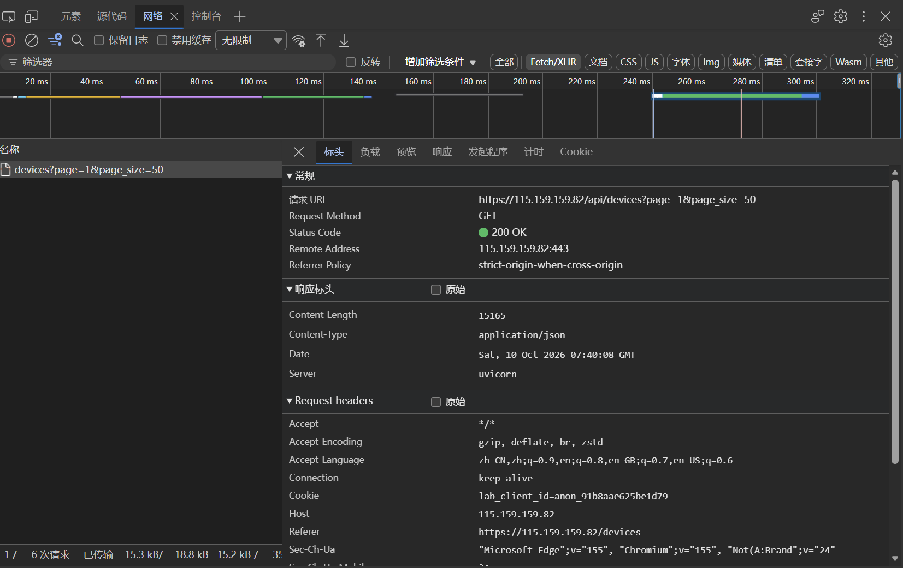
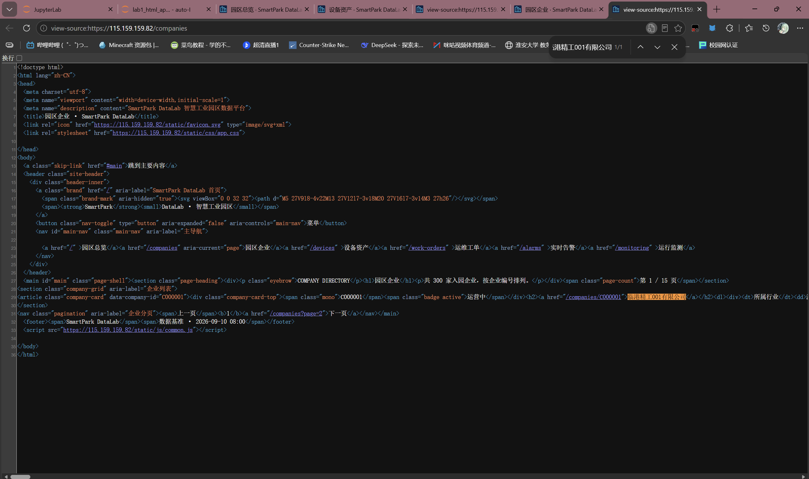
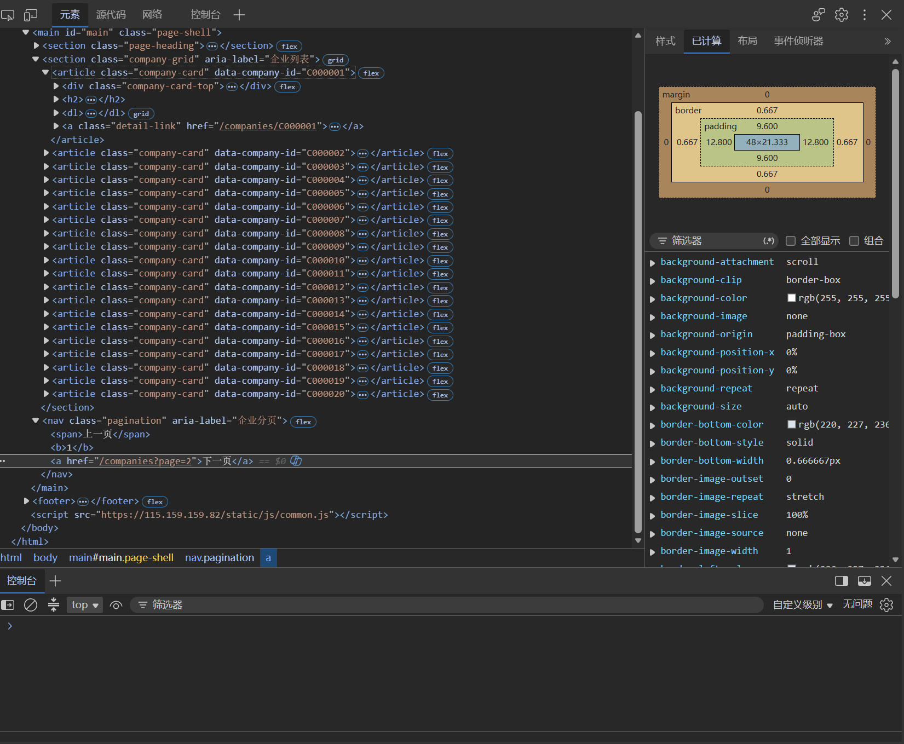
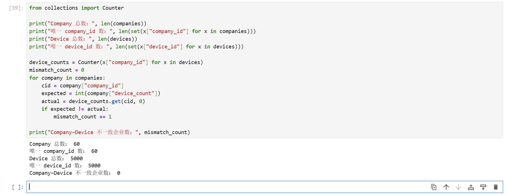

# Lab 1 实验报告

## 学生信息

- **姓名：** 魏之轩
- **学号：** 112404260134
- **班级：** 数据1241
- **GitHub 用户名：** Kura-ri
- **仓库地址：** https://github.com/Kura-ri/Bigdata-collection-labs-112404260134

> 文件位置：`lab01/REPORT.md`  
> 完整代码保存在 `lab1_html_api.ipynb`。  
> 本报告只填写关键发现、关键代码、结果和指定截图，**不要把整份 Notebook 复制进来**。

---

# 任务 1：判断数据加载方式

## 1.1 Device：判断动态加载并找到 API

### 判断结果

- 页面：`/devices`
- 数据加载方式：`动态加载`
- 判断依据：

在浏览器"右键 → 查看网页源代码"中按 `Ctrl+F` 搜索页面上的设备名称，**搜不到**任何一条设备记录，说明设备数据不随初始 HTML 返回；随后打开 `F12 → Network → Fetch/XHR` 并刷新页面，找到一个返回设备 JSON 数据的 XHR 请求，确认设备数据是通过 API 动态加载的。

### API 信息

- Request URL：`https://115.159.159.82/api/devices`
- Request Method：`GET`
- Query 参数：`page`（当前页码，从 1 开始）、`page_size`（每页条数，50）

### 【截图 1】Device API 发现证据



截图中可以看到 Network 面板选中了返回设备列表的 Fetch/XHR 请求 `devices?page=1&page_size=50`，右侧 Headers 显示 Request URL、GET 方法、200 状态码，URL 中可见 `page` 和 `page_size` 分页参数。

---

## 1.2 Company：判断静态加载

- 页面：`/companies`
- 数据加载方式：`静态加载`
- 判断依据：

使用"右键 → 查看网页源代码"打开 `/companies` 的源代码页面，按 `Ctrl+F` 搜索页面中真实显示的企业名称"临港精工001有限公司"，**能够在源代码中找到**该企业记录（含 `data-company-id="C000001"` 属性），说明企业数据随 HTML 一起返回，可按静态页面处理：`requests → r.text → BeautifulSoup → CSS Selector`。

### 【截图 2】Company 静态加载证据



---

# 任务 2：Device API 分页采集

## 2.1 API 分页结构

从第一页响应 JSON 中观察到的字段：

| 含义   | JSON 字段 |
| ---- | ------- |
| 当前页  | `page` |
| 每页条数 | `page_size` |
| 设备总数 | `total` |
| 设备列表 | `items` |

---

## 2.2 关键代码

```python
# 从第一页响应中读取分页信息
total = data["total"]
page_size = data["page_size"]

total_pages = (total + page_size - 1) // page_size

devices = []

for page in range(1, total_pages + 1):
    r = requests.get(
        api_url,
        params={
            "page": page,
            "page_size": page_size
        },
        timeout=10
    )

    page_data = r.json()
    page_items = page_data["items"]
    devices.extend(page_items)
```

---

## 2.3 采集结果

- 每页条数：50
- 设备总数：5000
- 程序计算得到的总页数：100
- 最终采集设备数：5000
- 唯一 `device_id` 数：5000

回答：

> 为什么总页数应由 API 返回的 `total` 和 `page_size` 计算，而不是直接在代码里写死？

答：`total` 和 `page_size` 是数据源的真实分页信息，用 `(total + page_size - 1) // page_size` 向上取整计算总页数，可以保证无论数据量怎么变化（设备增减、每页条数调整），程序都能自动采集到完整数据；写死页数则在数据变多时会漏采、数据变少时会请求到空页，程序失去通用性。

---

# 任务 3：Company HTML 解析

## 3.1 企业记录 Selector

- 企业记录 selector：`section.company-grid article.company-card`
- 第 1 页企业记录数：20

说明为什么选择这个 selector：

- 主要使用了 `id / class / data-* / 父子层级` 中的哪一种？
- 是否参考过浏览器 Copy selector 或 AI？
- 最终为什么采用现在这个写法？

答：主要使用了 **class + 父子层级**。通过浏览器 Elements 面板观察，每条企业记录是 `<article class="company-card" data-company-id="C000001">`，外层列表容器是 `<section class="company-grid">`。参考浏览器 Copy selector 的思路后，没有采用它给出的长 `nth-child` 路径，而是写成 `section.company-grid article.company-card`：既用两层 class 明确锁定"企业列表区里的企业卡片"，避免误选页面其他位置的卡片，写法又短、语义明确，对页面结构变化（如卡片数量增减）不敏感。

---

## 3.2 关键代码

```python
cards = soup.select("section.company-grid article.company-card")

card = cards[0]

company_id = card.get("data-company-id")
name = card.find(string=lambda s: s and "有限公司" in s).strip()
status = card.select_one("span.badge").get_text(strip=True)
```

行业、区域、设备数量使用 `dt/dd` 结构后，请写出你最终如何得到：

```python
details = {}
for item in card.select("dl > div"):
    details[item.select_one("dt").get_text(strip=True)] = \
        item.select_one("dd").get_text(strip=True)

industry = details["所属行业"]
zone = details["所在区域"]
device_count = int("".join(ch for ch in details["设备数量"] if ch.isdigit()))
```

---

## 3.3 字段来源说明

1. 字段：`company_id`
   - 来自：`HTML 属性`
   - 使用的方法：企业卡片 `<article>` 上带有 `data-company-id="C000001"` 属性，用 `card.get("data-company-id")` 直接读取 HTML 的 `data-*` 属性，无需解析文本。
2. 字段：`name`（企业名称）
   - 来自：`文本`
   - 使用的方法：企业名称是卡片内某标签的文本内容，使用 `card.find(string=lambda s: s and "有限公司" in s)` 按文本内容匹配定位节点后 `.strip()` 取出，不依赖具体的标签名，比按标签位置选择更稳定。

（另：`device_count` 的原始文本为"6 台"带单位，需过滤出数字字符后再用 `int()` 转换。）

---

# 任务 4：Company "下一页"分页

## 4.1 下一页元素

- "下一页" selector：`nav.pagination a:last-child`
- 第 1 页 `href` 示例：`/companies?page=2`

### 【截图 3】Company "下一页"元素



说明：页面底部分页区为 `<nav class="pagination" aria-label="企业分页">`，内部包含"上一页"的 `<span>` 和"下一页"的 `<a>`。截图 3 中可见"下一页"对应的 `<a>` 元素被选中，其 `href="/companies?page=2"`，是相对路径。

---

## 4.2 关键代码

```python
next_link = soup.select_one("nav.pagination a:last-child")

next_href = next_link.get("href")

next_url = urljoin(
    current_url,
    next_href
)
```

再用 2～3 句话说明：

> 你的程序如何完成"当前页 → 找下一页 href → 请求下一页 → 再解析"的循环？

答：程序用 `current` 变量记录当前页 URL，每轮循环先 `requests.get(current)` 获取页面并用 BeautifulSoup 解析出本页全部企业记录；然后用 selector 找到"下一页"的 `<a>`，取出相对路径 `href`，用 `urljoin(current, href)` 拼接成完整的下一页 URL 赋回 `current`；下一轮循环请求新 URL 继续解析，共循环 3 次。若某页找不到"下一页"链接则 `break` 结束。

---

## 4.3 三页采集结果

| 页码     | 企业数 |
| ------ | --: |
| 1      | 20 |
| 2      | 20 |
| 3      | 20 |
| **合计** | 60 |

- 唯一 `company_id` 数：60

---

# 任务 5：结果验证

## 5.1 最终结果

| 检查项                   | 结果 |
| --------------------- | -: |
| Company 总数            | 60 |
| 唯一 `company_id`       | 60 |
| Device 总数             | 5000 |
| 唯一 `device_id`        | 5000 |
| Company–Device 不一致企业数 | 0 |

### 【截图 4】最终验证结果



---

## 5.2 一致性检查关键代码

```python
from collections import Counter

device_counts = Counter(
    x["company_id"] for x in devices
)

mismatch_count = 0

for company in companies:
    cid = company["company_id"]
    expected = int(company["device_count"])
    actual = device_counts.get(cid, 0)

    if expected != actual:
        mismatch_count += 1
```

回答：

> 为什么 `status_code == 200` 仍然不能说明"数据已经采集正确"？

答：`200` 只代表 HTTP 请求本身成功、服务器返回了响应，不代表响应里的数据是完整的、正确的。例如分页参数写错时每页仍返回 200 但条数不足、字段解析 selector 写错时提取结果为空、返回的 JSON 结构变化都会导致"请求成功但数据错误"。所以必须再做数量核对（60/5000）、ID 唯一性检查和跨数据源一致性校验，才能确认采集正确。

---

# 任务 6：保存采集结果

确认已经生成：

```text
data/companies.json
data/devices.json
```

填写：

- `companies.json`：`已生成`
- `devices.json`：`已生成`

不需要截图 JSON 全文，也不需要把 JSON 内容复制到报告。

---

# 实验结论

本实验中，动态加载页面（/devices）的数据不在初始 HTML 里，需要通过 F12 Network 抓包定位 JSON API，再用 requests 模拟请求并按 `total`/`page_size` 计算页数循环采集；静态页面（/companies）的数据随 HTML 返回，直接 requests + BeautifulSoup + CSS Selector 解析即可。API 分页由程序根据返回字段计算页数自动翻页，HTML 分页则靠解析"下一页"的 href 并用 urljoin 拼接 URL 驱动循环。采集完成后通过记录总数核对、ID 唯一性检查以及 Company 页面 device_count 与 Device API 实际统计的一致性比对（不一致数为 0）验证了结果，最终 60 家企业与 5000 台设备数据完整、无重复、跨源一致。
