# 实验二报告：房源采集与 MySQL 存储

- 班级：数据1241
- 姓名：魏之轩
- 学号：112404260134
- 实验日期：2026-10-27 ～ 2026-11-06
- GitHub 仓库链接：https://github.com/Kura-ri/Bigdata-collection-labs-112404260134
- 源码文件名：`lab02/anjuke.ipynb`
- 数据库与表：`smartpark_lab.houseinfo`
- 数据来源：在线教学站（http://www.bspider.top/anjuke/）
- 访问时间及结果（若失败，填写状态码、页面标题或报错）：2026-10-27 15:07 首次访问，状态码 200，标题「重庆二手房房产网，重庆二手房出售，重庆买房购房交易信息 - 58安居客」，返回房源 60 条。只带简单 User-Agent 时曾返回「访问验证-安居客」页面（状态码也是 200，但 div.property 为 0），按下面第二阶段说明改用完整浏览器请求头后恢复正常。
- 快照文件来源与文件名（在线实验可写“不适用”）：不适用（在线采集成功，未使用网页快照）

> 填写要求：截图放在 `images/` 中，在对应位置插入图片。代码截图要显示文件名、行号或单元位置，用红框标出关键代码，每项写2—3句话解释。只截最终结果或只贴 AI 生成的文字，不能代替实验过程。未完成的项目写明原因，不填写预期结果，不展示个人账号密码。

## 第一阶段：MySQL Docker 更新与启动

- 本次是否需要更新：**已完成更新**（本次按 L05 更新包说明更新）
- 更新或启动遇到的问题：无。更新包 5 个文件已放入课程目录 `E:\BigDataCourse\`，与包内 SHA256 校验一致；`docker load -i mysql-8.4.11-amd64.tar` 导入后镜像 ID 为 `sha256:85b9bf2e29cf836ecb8c2a15a935d4ba0c606631dff1dd79531a11983c638f2a`，与更新包说明一致；`start-mysql.bat` 输出 `[PASS] L05 MySQL healthy，账号连接检查通过。`

### 启动环境与建表

依次使用 `start-course.bat`、`start-mysql.bat`、`mysql-console.bat` 启动课程环境、数据库和 MySQL 终端。

**截图：** MySQL 启动成功提示，以及终端中 `USE smartpark_lab`、`SHOW TABLES`、`DESCRIBE houseinfo` 的执行结果。可分图。

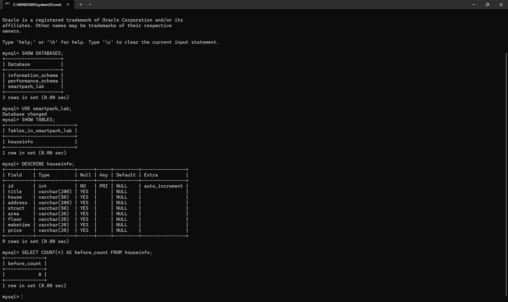

上图为 `mysql-console.bat` 打开的课程 MySQL 终端：`SHOW DATABASES` 确认教学库 `smartpark_lab` 存在；`USE smartpark_lab` 后 `SHOW TABLES` 显示本次新建的 `houseinfo` 表；`DESCRIBE houseinfo` 列出 9 个字段（自增主键 `id` 加 8 个房源字段）；`SELECT COUNT(*)` 记录入库前条数 `before_count = 0`，供第三阶段计算新增条数。

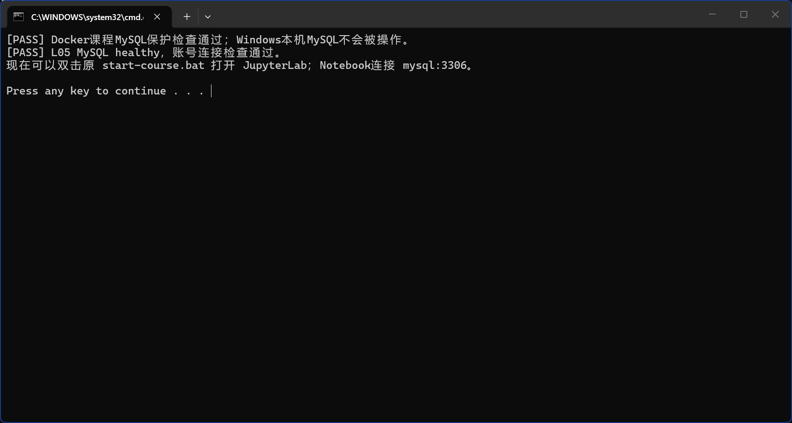

上图为 `start-mysql.bat` 的输出：先通过 Docker 课程 MySQL 保护检查（不触碰 Windows 本机 MySQL），随后 L05 MySQL healthy、账号连接检查通过。

说明：当前使用哪个数据库？`id` 和8个房源字段分别保存什么？

答：当前使用课程 Docker 中的教学数据库 **`smartpark_lab`**（MySQL 8.4.11，服务名 `mysql`，端口 3306，账号 `student`）。库中新建的表是 **`houseinfo`**，字符集 `utf8mb4`。

- `id`：`INT AUTO_INCREMENT PRIMARY KEY`，自增长主键，由数据库自动生成，不来自网页，用来唯一标识一行记录、并保证入库顺序可追溯。
- `title`（VARCHAR 200）：房源的卖点标题。
- `house`（VARCHAR 50）：楼盘名称。
- `address`（VARCHAR 200）：地址，可能由多个子标签拼成，取完整文字。
- `struct`（VARCHAR 50）：户型，如“3室2厅1卫”。
- `area`（VARCHAR 20）：建筑面积，**保留面积单位**，所以不用数值类型。
- `floor`（VARCHAR 20）：楼层，注意不要取成朝向。
- `maketime`（VARCHAR 20）：建造年代，缺失时存空字符串。
- `price`（VARCHAR 20）：**每平方米单价**，不是万元总价，同样保留单位。

建表后 `DESCRIBE houseinfo` 显示 9 个字段；入库前 `SELECT COUNT(*) AS before_count FROM houseinfo` 结果为 **0**。

## 第二阶段：房源采集与 CSV 数据存储

### 1. 网页分析与房源解析

#### 选择器是怎样得到的

在 Chrome 中按 F12，使用 **Elements → Copy → Copy selector**。选一个字段，记录从完整路径到相对选择器的过程。

- 选择的字段：标题 title
- 复制的原始选择器：`#app > div > div:nth-child(3) > div.list-content > div.property:nth-child(1) > a.property-ex > div.property-content > div.property-content-detail > div.property-content-title > h3`
- 一条房源的父容器选择器：`div.property`
- 最终使用的相对选择器：`h3.property-content-title-name`

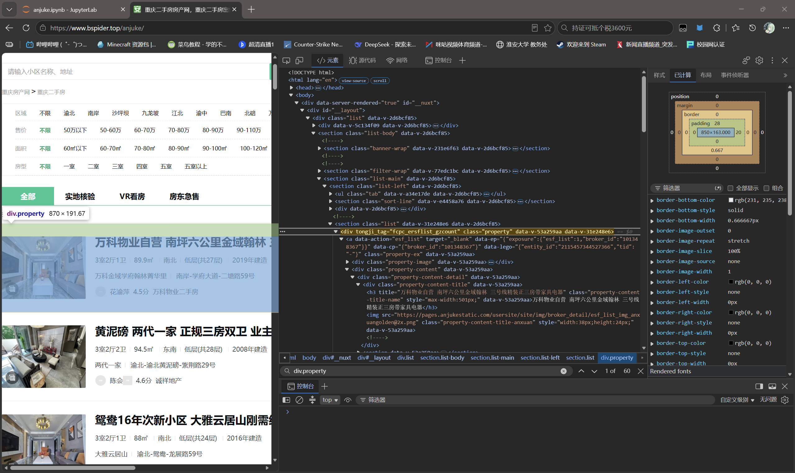

上图为 Chrome F12 的 Elements 面板：选中房源节点后从面包屑定位到父容器 `div.property`；在搜索框输入 `div.property` 显示 **1 of 60** 个匹配，确认该容器在列表页中刚好每页匹配 60 条房源，与 `soup.select("div.property")` 的返回数量一致。

说明：删掉了哪些层级？怎样确认父容器刚好包含一条房源？

答：Copy selector 复制出来的是从页面根节点一路到 h3 的完整路径，中间有 `div:nth-child(3)`、`div.property:nth-child(1)` 这种靠位置定位的层级。我把从根节点到 `div.property` 之间的层级全删了，只保留从房源容器往下的相对路径，最后简化成 `h3.property-content-title-name`。原因是页面上一旦插入一个广告位或者顺序变了，`:nth-child(3)` 就会指错，而 `div.property` 加 class 名不受位置影响。

确认父容器：在 Elements 里把鼠标移到一个节点上，看网页上高亮的那块区域是不是刚好盖住一条房源（图片、标题、属性、价格都在里面，不多不少），再点第二条看 class 是不是也叫 property。另外在 Elements 的搜索框里搜 `div.property`，显示 1 of 60，说明整个列表页正好 60 个，和页面上房源条数、Python 里 `select("div.property")` 返回的 60 条都对得上。

#### 解析8个字段

**截图：** 自己编写的解析代码和首条房源的8个字段输出。代码中必须框出：

- `select()` 和 `select_one()`。
- 面积、单价的定位与取值。
- 建造年代的提取和缺失处理。

可分成几张局部截图。另附面积、单价对应的 HTML 节点或网页原文。

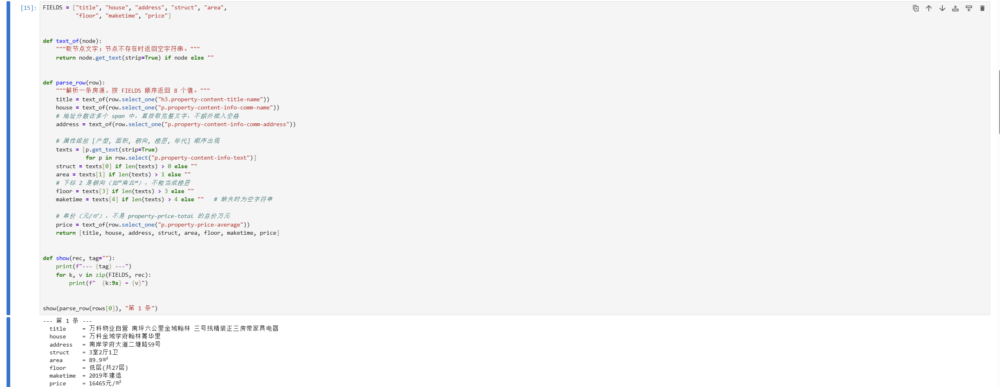

上图为自编解析函数 `parse_row`：用 `select_one()` 在一条房源内取标题/楼盘/地址/单价，用 `select()` 取属性组列表后**按下标**取面积 `texts[1]`、楼层 `texts[3]`（下标 2 是朝向「南北」，跳过）、年代 `texts[4]`（缺失时为空字符串）；单价取 `p.property-price-average` 而非总价。下方为首条房源的 8 字段输出，可逐字段对照网页核对。

说明：两个选择方法各用在哪里？怎样确认面积和单价没有取错？

答：`select()` 取的是"一组"元素，用在了两处：`soup.select("div.property")` 拿整个列表页的所有房源，`row.select("p.property-content-info-text")` 拿一条房源里那串属性（户型、面积、朝向、楼层、年代）。`select_one()` 取的是"唯一一个"，用在标题、楼盘、地址和单价上，因为一条房源里这些各只有一个，多拿反而容易错。

面积和单价是逐项确认后才敢用的。先把属性组每一项打印出来看顺序，得到 [0]3室2厅1卫 [1]89.9㎡ [2]南北 [3]低层(共27层) [4]2019年建造，第 3 项"南北"其实是朝向——如果按感觉取 `texts[2]` 当楼层就取错了，所以我取的是 `texts[1]` 和 `texts[3]`。单价特意取 `p.property-price-average`（显示 16465元/㎡），没有取 `property-price-total`（那是 148 万的总价），取完把第 1 条和第 600 条的值拿去和网页上显示的数字逐一对过，单位也保留了。

### 2. 下一页采集

- 下一页 `href` 原值：`?page=2`
- 用 `urljoin()` 补全后的地址：`http://www.bspider.top/anjuke/?page=2`
- 实际停止原因（明确禁用的末页按钮 / 异常中止）：明确禁用的末页按钮——第 10 页 `a.next` 节点还在，但 class 里已经没有 `next-active`，`href` 变成 `#`

**截图：** 框出提取 `href`、补全地址、循环更新地址和停止条件的代码。附前两页的运行日志，以及最终停止提示。离线实验展示快照中的href、补全结果和文件读取记录，注明“离线回放”，不算在线翻页成功。

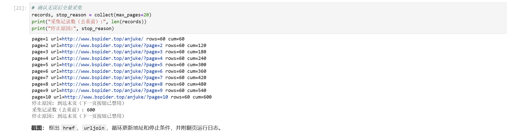

上图为全量采集（`max_pages=20`）的完整运行日志：从第 1 页到第 10 页逐页输出 `rows=60 cum=…`，累计 **600** 条；最终停止原因为「**到达末页（下一页按钮已禁用）**」，即第 10 页分页区仍存在、`a.next` 节点保留但无 `next-active` class 且 `href="#"`，属于任务书认定的正常采集完成，而非结构异常或达到安全页数上限的中止。

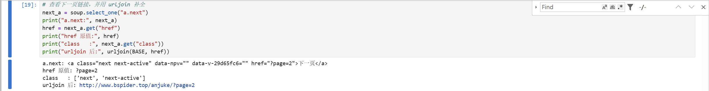

上图展示 `a.next` 的定位：`href` 原值为 `?page=2`，class 为 `['next', 'next-active']`；经 `urljoin(BASE, href)` 补全为完整地址 `http://www.bspider.top/anjuke/?page=2`。

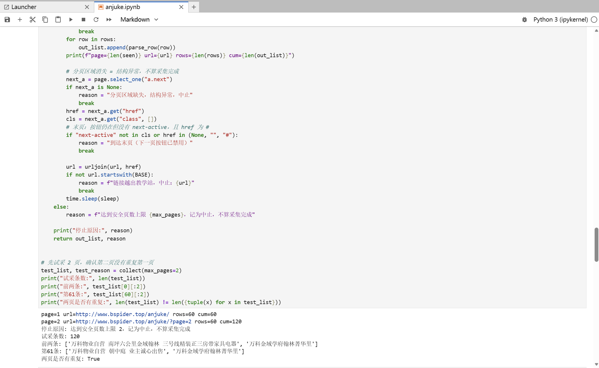

上图为自编 `collect_the_pages()` 循环：每页请求→解析→`urljoin` 更新地址→`time.sleep(1)` 礼貌间隔；停止条件包含**末页判定**（`a.next` 缺少 `next-active` class 或 `href="#"`）、重复地址、空列表、链接越出教学站、安全页数上限五种，防止重复采集与无限循环。下方为先试采 2 页的运行日志。

说明：怎样进入下一页？怎样防止重复采集或无限循环？若中途失败，说明停在哪一步。

答：每页解析完，用 `soup.select_one("a.next")` 找底部分页区的"下一页"，`get("href")` 拿到的是 `?page=2` 这种相对地址（不是 `get_text()`，那个只会得到"下一页"三个字），再用 `urljoin(当前地址, href)` 拼成完整地址，赋回给 `url` 继续下一轮 while。

防重复和死循环用了几个办法：访问过的地址都放进 `seen` 集合，下一轮开头先判断地址是否已访问过，重复就中止；`while url and len(seen) < max_pages` 里设了 20 页的安全上限，一旦是靠上限退出的，只记为中止、不算采集完成；请求异常、本页解析出 0 条、拼出来的地址不以教学站开头，也都直接 break 并记原因。按任务书要求先试采 2 页，确认第 2 页的 60 条和第 1 页不是同一批（累计到 120）才跑全量。这次中途没有失败，第 10 页正常停。

### 3. 保存 CSV

**截图：** CSV保存与回读代码、回读条数。框出编码、表头和数据写入部分。

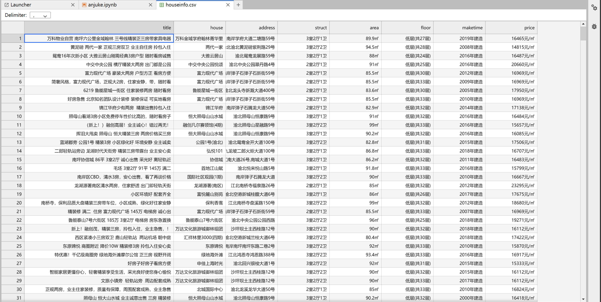

上图为 JupyterLab 中打开的 `data/houseinfo.csv` 表格视图：表头 8 个字段顺序与任务书一致，第 1 行起为数据。

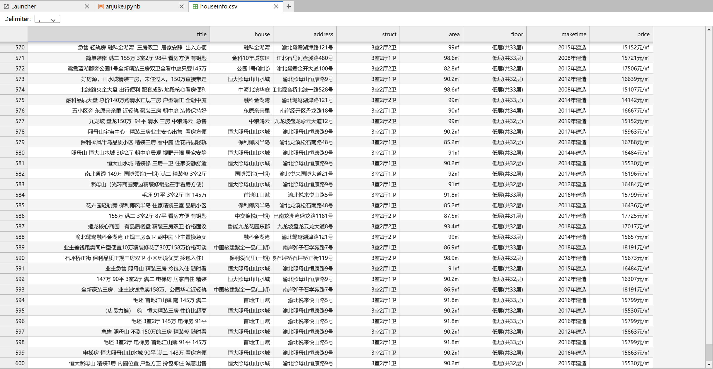

上图行号显示至 **600**，即不含表头的数据行数；最后一行（第 600 行）为「恒大照母山 精装3房 … / 90.2㎡ / 2015年建造 / 15530元/㎡」，与采集末页最后一条一致。

说明：8个字段的顺序是什么？按8个字段完全相同去重后，保存了多少条记录？

答：CSV 表头顺序与任务书一致：`title → house → address → struct → area → floor → maketime → price`，共 8 个字段，写入时用 `csv.writer`、编码 `utf-8-sig`、`newline=""`。本次不查重，直接保存采集到的全部记录，共 **600 条**数据行（文件总行数 601，含表头）。回读用 `csv.DictReader`，数据行数 600，与保存条数一致；抽取第 1 条、第 61 条（跨页）、最后一条与网页逐字段核对一致。

## 第三阶段：MySQL 数据存储

### 1. 读取 CSV 并入库

本阶段读取第二阶段的 `data/houseinfo.csv`，不重新采集。

**截图：** 框出读取CSV、按8个字段整理入库参数的代码。

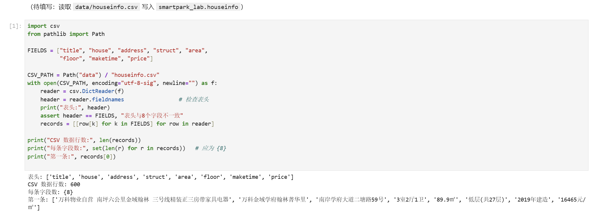

上图为读取 `data/houseinfo.csv` 的代码：用 `csv.DictReader` 读入后先检查表头与 8 个字段一致（`assert`），再按 `FIELDS` 固定顺序整理成 `records`（每条 8 个值），输出确认 600 条、每条字段数为 8。

**截图：** 自己编写的入库代码。框出 `executemany()`、`commit()`、`rollback()`，以及关闭游标和连接的操作。另框出避免重复插入的代码。

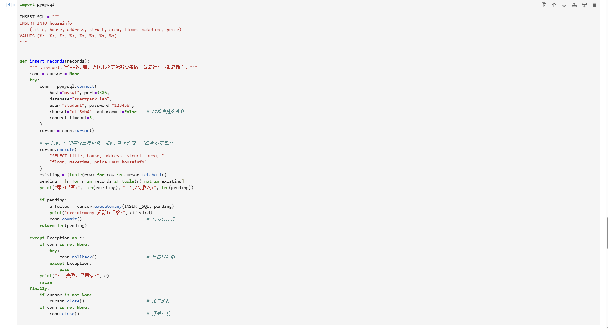

上图为自编入库函数 `insert_records()`：`INSERT_SQL` 用 8 个 `%s` 占位对应 8 个字段；连接设 `autocommit=False`，由程序提交事务；先按 8 个字段读取库内已有记录（`existing` 集合）并算出 `pending`，实现**避免重复插入**；`cursor.executemany()` 批量写入后 `conn.commit()`；异常时 `conn.rollback()` 并抛出；`finally` 中先 `cursor.close()` 再 `conn.close()` 释放资源。

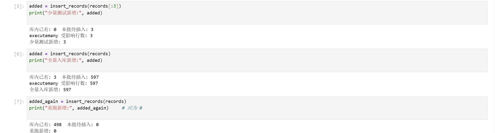

上图为入库的三次运行：先用 3 条真实记录测试（库内已有 0 → 受影响 3），再全量入库（库内已有 3 → 待插入 597，`executemany` 受影响 597，成功后 `commit()`），最后**关闭程序后独立重跑同一批 600 条**——防重复逻辑按 8 个字段比较已有记录，待插入 0，未再执行 INSERT，新增为 0。注：「库内已有 498」是防重复集合合并了库内 102 条完全相同的重复房源后的不同值个数，库中实际行数为 600。

说明：每条记录怎样对应8个参数？成功、失败时分别做什么？再次运行时怎样避免重复插入？

答：`records` 里每条记录都是按 `[title, house, address, struct, area, floor, maketime, price]` 这个固定顺序整理的 8 个值，INSERT 语句里也正好是这 8 个字段对 8 个 `%s` 占位，所以 `executemany` 直接用元组列表传进去，顺序一一对应，没有用 f-string 或字符串拼接（会出 SQL 注入和引号问题）。

成功时 `conn.commit()` 提交事务，提交后在另一个 MySQL 终端里才查得到新数据；出错时在 `except` 里 `conn.rollback()` 把这一批撤销，再把异常抛出去，不会留下写了一半的数据；不管成功失败，`finally` 里都先 `cursor.close()` 再 `conn.close()`，因为连接对象可能在 connect 那一步就没建起来，所以关之前先判断是不是 None。

再次运行避免重复：入库前先 `SELECT` 出库里已有记录的 8 个字段做成集合 `existing`，只把不在集合里的放进 `pending`，再对 `pending` 执行 `executemany`。这样第二次跑同一批数据时 `pending` 是 0，一条都不会插，也不会靠清空表来重跑。

### 2. 核对结果

#### 查询条数和样本

**截图：** MySQL 终端中的入库前后 `SELECT COUNT(*)`、重跑后的条数，以及 `SELECT ... LIMIT 5` 的结果。

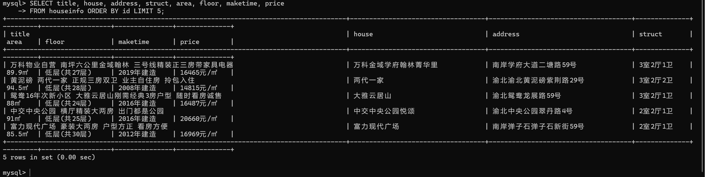

上图为 `mysql-console.bat` 打开的课程 MySQL 终端：`SELECT COUNT(*)` 显示入库后条数 `after_count = 600`；`SELECT … ORDER BY id LIMIT 5` 的前 5 条样本（标题、楼盘、地址、户型、面积、楼层、年代、单价）与 CSV 前 5 行逐字段一致。终端先执行 `charset utf8mb4;` 使中文正常显示。

| 项目 | 实际结果 |
|---|---|
| 成功采集页数 | 10 |
| 采集记录数（去重前） | 600 |
| 完全相同的重复记录数 | 未统计（本次不查重） |
| CSV数据行数（不含表头） | 600（不查重，直接保存全部采集记录） |
| 入库前条数 | 0 |
| 入库后条数 / 本次新增条数 | 600 / 600（少量测试 3 条 + 全量 597 条） |
| 关闭上次程序后，同批数据独立重跑的条数 / 新增条数 | 600 / 0（防重复逻辑生效，未重复插入） |
| 是否采集完整；未完成的原因 | 完整：10 页全部采完，末页「下一页」按钮已禁用，无未完成步骤 |

说明：首次入库后的条数应等于去重后的CSV数据行数，8个字段的内容也应一致。若不一致，说明原因。总条数以实际结果为准。

答：入库前是 0 条，我先用 3 条真实记录试了一次（受影响 3 行），再把剩下的全量写进去（待插入 597 条，受影响 597 行），加起来正好 600 条，和 CSV 的数据行数 600 一样，说明每条都进去了、没有漏也没有多。

重跑验证：把程序关掉重新连一次，还是同一批 600 条，这时库内已有 600 条，待插入算出来是 0，一条都没插，总条数还是 600，说明防重复那段是有效的。

说明里提到"去重后的CSV行数"，本次按个人要求 CSV 没有做去重（600 条全存），所以这里比的是"CSV 数据行数 600"，两边一致。8 个字段的内容也用下面的样本逐条核对过，没有差异。

#### 逐条核对

选取第一条、跨页一条和最后一条，比较网页、CSV与数据库中的8个字段。快照实验对照教师提供的网页文件。

**截图：** 三条样本的对照结果，框出面积、单价和年代。可分图。

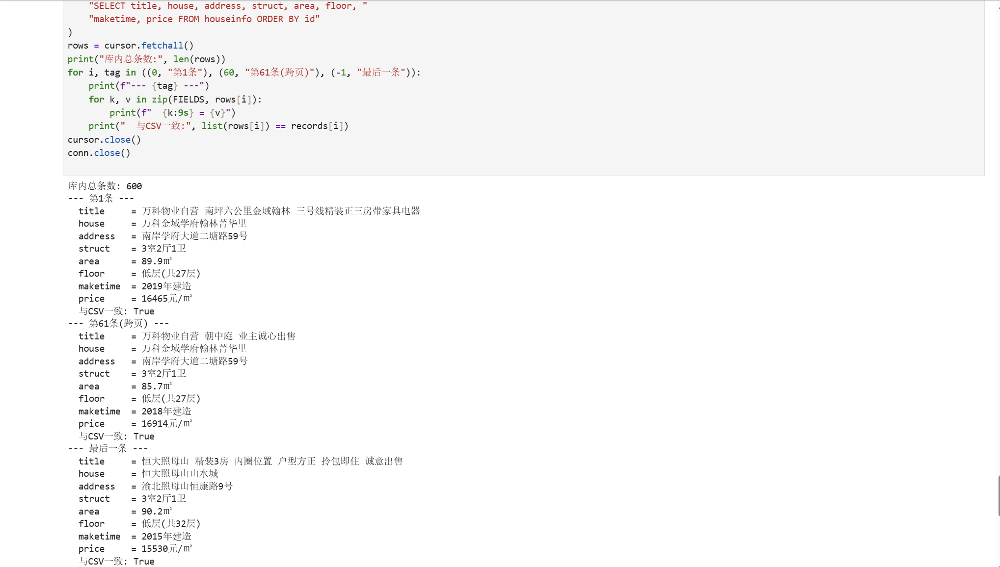

上图为按 `ORDER BY id` 回读数据库后的三条样本（第 1 条、跨页第 61 条、最后一条）与 CSV 逐字段比较，8 个字段全部 `与CSV一致: True`；面积（89.9㎡ / 85.7㎡ / 90.2㎡）、单价（16465 / 16914 / 15530 元/㎡）、年代（2019 / 2018 / 2015 年建造）均与 CSV 及网页一致，库内总条数 600。

- 样本1（页码或URL、记录位置）：第 1 页第 1 条，`http://www.bspider.top/anjuke/`，库内 id=1，万科物业自营 南坪六公里金域翰林 三号线精装正三房带家具电器
- 样本2（页码或URL、记录位置）：跨页样本，第 2 页第 1 条（整体第 61 条），`http://www.bspider.top/anjuke/?page=2`，库内 id=61，万科物业自营 朝中庭 业主诚心出售
- 样本3（页码或URL、记录位置）：第 10 页最后一条（整体第 600 条），`http://www.bspider.top/anjuke/?page=10`，库内 id=600，恒大照母山 精装3房 内圈位置 户型方正 拎包即住 诚意出售

核对结论及差异：三条记录的 8 个字段在网页、CSV、数据库三处都一致，没有差异。重点核对的三项：面积 89.9㎡ / 85.7㎡ / 90.2㎡（单位没丢，也没把朝向当面积）；单价 16465 / 16914 / 15530 元/㎡（是每平方米单价，不是 148万、143万这种总价）；年代 2019 / 2018 / 2015 年建造（第 3 条和其他两条落在同一楼盘同一年代区间，没出现空值或错位）。地址栏也能看出是分段拼起来的完整地址，比如"南岸学府大道二塘路59号"，中间没有多插空格。

## 问题与解决

- 遇到的问题、处理方法及结果（没有可写“无”）：
  1. 反爬验证页。第一次只带 `User-Agent: Mozilla/5.0` 请求，返回的标题是"访问验证-安居客"，状态码却是 200，`div.property` 一个都没有。开始以为是选择器写错了，在浏览器里对照后发现页面根本不是房源列表。换成完整的浏览器请求头（本机 Chrome 的完整 UA，加上 Accept、Accept-Language、Referer、Sec-Fetch 这些）之后就能正常拿到 60 条了。教训是状态码 200 不代表拿到了想要的内容，得检查页面标题和条数。
  2. 楼层取成朝向。按属性组顺序取第 3 项当楼层，结果拿到的是"南北"。先把属性组每一项打印出来确认顺序，改成取下标 3，并在代码里写注释说明下标 2 是朝向。
  3. MySQL 终端中文显示成 `????`。数据本身没问题（Notebook 回读是正常中文），是终端字符集的问题。先试 `charset gbk;` 反而变成"锘?"，因为终端是 UTF-8；最后执行 `charset utf8mb4;` 就正常了。
  4. Jupyter 里跑旧版 Notebook 把 CSV 覆盖过一次（去重版本把 600 行写回 498 行）。后来关掉旧标签页重新打开、统一用保存全部记录的版本，问题解决。
- 尚未解决的问题、未完成的步骤（没有可写“无”）：没有未完成的步骤。有一点要说明：这个教学站本身存在跨页重复房源，600 条里有 102 条是 8 个字段完全相同的重复记录，本次按要求没有做去重，CSV 和数据库里都保留了全部 600 条。

## 思考题

1. 本次怎样实现下一页采集？结合自己的代码说明。

   答：先 `next_a = soup.select_one("a.next")` 定位分页区里的"下一页"，用 `next_a.get("href")` 拿到原值 `?page=2`（这里要注意不能写 `get_text()`，那只能拿到"下一页"三个字，不是地址）。因为这个地址是相对的，用 `urljoin(当前url, href)` 补成 `http://www.bspider.top/anjuke/?page=2` 再请求，新一轮的 `soup` 又从头解析。循环条件写的是 `while url and len(seen) < max_pages`，每轮先看 `url` 是否在 `seen` 里（防重复）、是否以 BASE 开头（防跑出教学站）、本页条数是否为 0（防空页），然后判断停止条件：`a.next` 的 class 里没有 `next-active`，或者 `href` 是 `#`，就说明按钮已禁用、到末页了，break 并把原因记下来。最后还留了 `max_pages=20` 兜底，靠它退出的只算中止不算完成。

2. 旧代码把 out_list 定义在全局。你把结果列表放在哪里？为什么？

   答：我放在 `collect_the_pages()` 函数内部，作为局部变量 `out_list`，函数结束时和停止原因一起 `return out_list, reason`。放全局的话重复调用会一直往同一个列表里追加，跑第二次就变成 1200 条，还得手动清空；而且调用方看不出哪些是这一次采的。放函数里每次调用都是干净的，还能把"为什么停"一起返回，主程序只拿返回值，不用去读全局变量。打印的时候我是打印 `len(out_list)` 来累计，避免重复遍历。

3. 你怎样获取建造年代？节点缺失或顺序改变时，怎样处理？

   答：建造年代在属性组里，我是取 `p.property-content-info-text` 列表的最后一项 `texts[4]`，取值前先判断 `len(texts) > 4`，不满足就给空字符串，这样节点缺失也不会抛 IndexError，写进 CSV 就是空值，符合任务书"缺失时填空字符串"的要求。顺序改变的风险是有的：如果某条房源没有朝向那一项，后面的元素整体前移，按固定下标就会错位。所以我是先把每条房源的属性组打印出来确认顺序才按下标取的；更稳妥的做法是按文字特征匹配（比如挑出带"年建造"的那一项），这次按任务书要求保持了简单写法，但心里清楚这个局限。

## 提交检查

- [x] 实验一原仓库的 `lab02/` 中已有源码、CSV、报告和真实截图。
- [x] 截图清楚，关键代码已框出，每项附有个人解释。
- [x] GitHub上能打开文件和图片，未上传个人账号密码、`.env`或教师答案。
- [x] 未完成项已如实说明；学习通只交原仓库链接。

如使用 AI，简述它帮助了什么，以及自己修改、运行和核对了什么：

答：AI 主要帮了三件事：一是环境启动报错时帮我定位原因（Docker 镜像要先用增量包导入、MySQL 容器的健康检查）；二是帮我一起看页面结构，确认房源容器是 `div.property`、属性组里第 3 项是朝向而不是楼层；三是我写完代码后帮我检查语法和异常处理的位置（rollback 和 finally 该放哪）。

下面这些是我自己做的：用 Chrome F12 一层层看节点、按 Copy selector 复制完整路径再改成相对选择器，截图里的 Elements 面板是我自己操作截的；8 个字段的取值我逐条打印核对，第 1 条、第 61 条和最后一条都拿去和网页上的原文比对过；代码是我自己敲进去并一个个 cell 跑通的，三次入库（3 条测试、597 条全量、0 条重跑）和 MySQL 终端里的 COUNT、LIMIT 5 都是我实际运行的结果，报告里的数字都是从我的运行输出里抄的；反爬验证页、楼层取错、终端中文乱码这几个问题也是我自己碰到后逐个试出来的。
