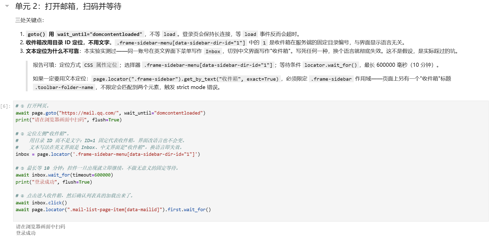
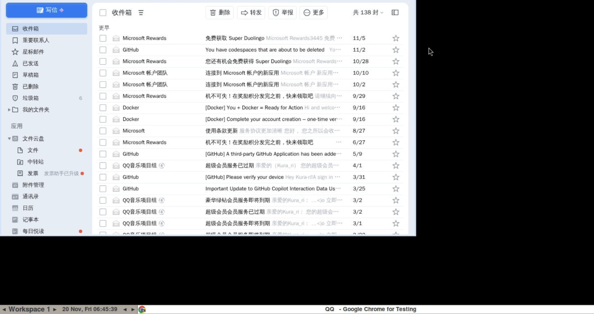
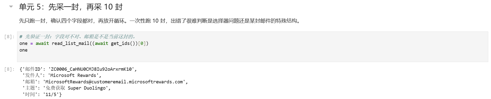
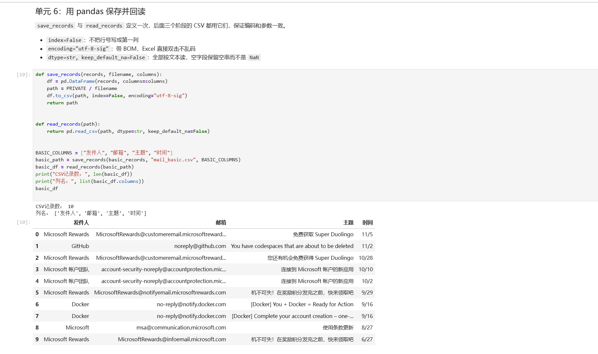
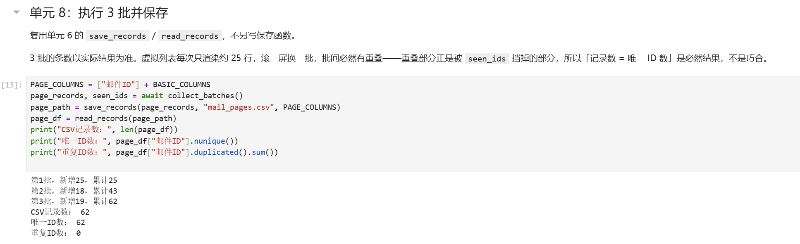
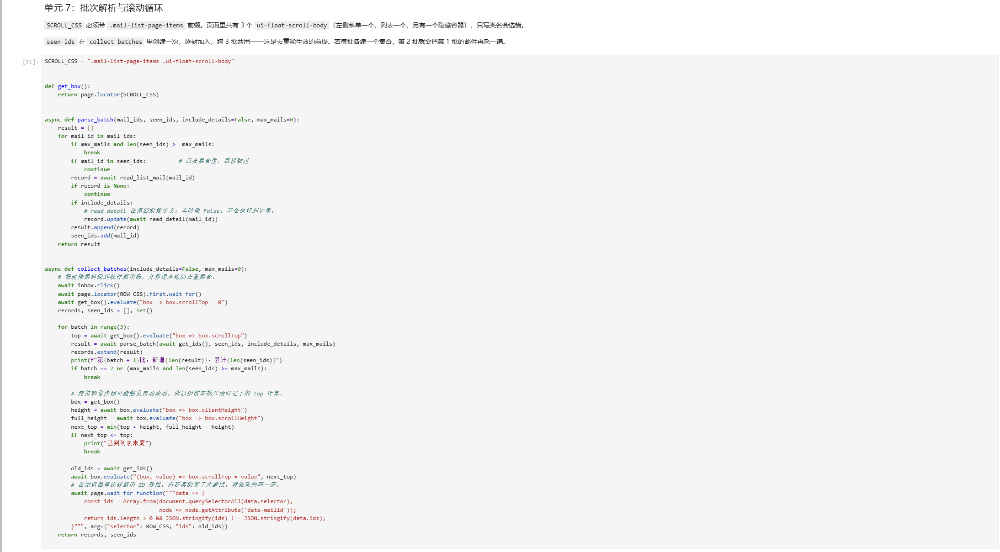
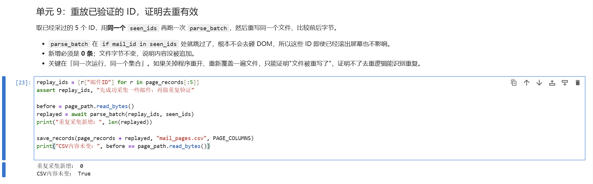
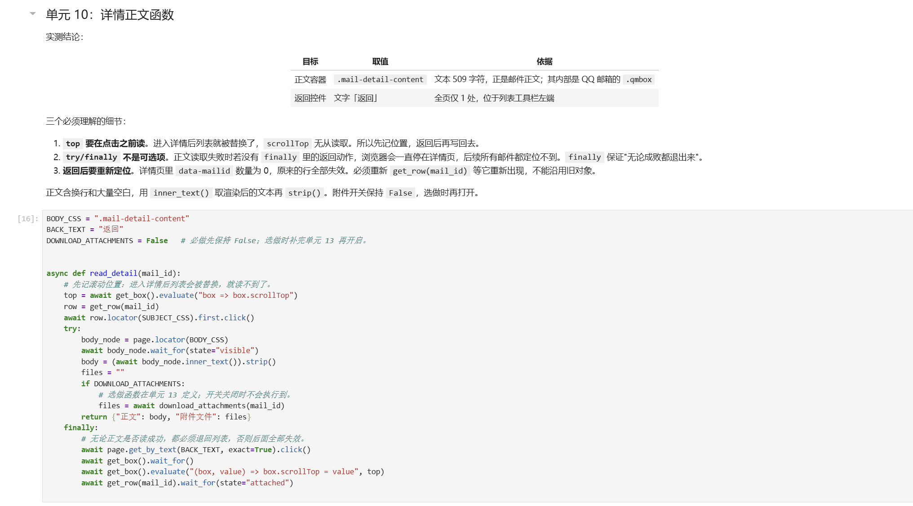
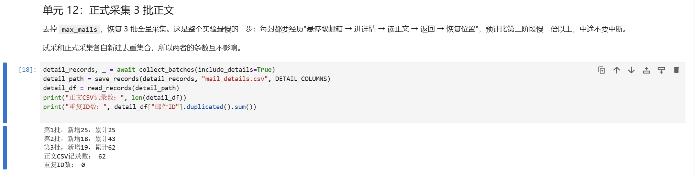

# 实验三报告：QQ邮箱采集（Playwright版）

- 班级：数据1241
- 姓名：魏之轩
- 学号：112404260134
- 第1—2课时实验日期：2026-11-20
- 第3—4课时实验日期：2026-11-20
- 第5—6课时实验日期：2026-11-20
- 第7—8课时实验日期：2026-11-20
- 所用工具：Playwright
- 工具版本与运行环境：Playwright 1.62.0（Python 异步 API）、Python 3.12、JupyterLab 4.6.3；运行于课程 Docker 容器，浏览器画面经 Xvfb + noVNC 输出到本机窗口
- 实验Notebook文件名：`qqmail_lab03_playwright.ipynb`
- GitHub原作业仓库链接：https://github.com/Kura-ri/Bigdata-collection-labs-112404260134
- 数据来源（教师练习邮件 / 自备无敏感练习邮件 / 其他，说明）：本人 QQ 邮箱收件箱（共 138 封，以服务通知类邮件为主），公开版 CSV 与截图均已脱敏

## 第一阶段：扫码登录（第1—2课时）

### 1. 环境和运行方式

- 使用的启动脚本：`start-course-visual.bat`
- 运行位置：Docker内JupyterLab的Notebook代码单元
- 自己新建的Notebook文件名：`qqmail_lab03_playwright.ipynb`
- 所选工具版本：Playwright 1.62.0
- 启动或依赖问题及处理：可视化增量包为预装状态，`connection.json` 中 `enabled=true`、显示号为 `:99`，无需重新安装。执行 `course_visual.prepare()` 把 `DISPLAY` 与 `XAUTHORITY` 注入当前内核环境变量后，`headless=False` 启动的 Chromium 画面即输出到本机 noVNC 窗口（`127.0.0.1:16080`），全程未修改容器配置。

**截图：** 环境成功运行和工具版本，注意遮挡可视化连接中的认证信息。

### 2. 扫码与登录判断

- 人工完成的操作：用手机 QQ 扫描浏览器画面中显示的二维码，完成身份认证
- 登录成功控件的定位方式和选择器：CSS 属性定位，`.frame-sidebar-menu[data-sidebar-dir-id="1"]`（收件箱目录项，目录 ID 固定为 1）
- 等待条件与最长等待时间：`locator.wait_for(timeout=600000)`，等待元素**可见**，最长 600000 毫秒（10 分钟），出现即继续
- 本次实际结果：扫码后数秒内打印「登录成功」；随后点击该项进入收件箱，目录名显示「收件箱」，工具栏显示「共 138 封」

**截图：** 登录判断代码和真实成功输出；若失败，附实际报错。

说明：程序如何区分“页面已打开”和“已经登录”？

答：登录页与收件箱对应两套完全不同的 DOM。登录页没有侧边栏目录项，只有登录成功后才渲染 `.frame-sidebar-menu` 节点。`wait_for` 等待的是「登录态下才存在的节点」，而不是固定时长，因此能严格区分「页面已加载」与「已完成登录」两种状态。

## 第二阶段：采集10封邮件并保存CSV（第3—4课时）

### 1. 页面分析与字段提取

| 目标 | 实际使用的定位方式 | 取值方法 |
|---|---|---|
| 一封普通邮件 | CSS 属性：`.mail-list-page-item[data-mailid]` | 读 `data-mailid` 属性 |
| 发件人 | CSS 类：`.cmp-account-nick` | `inner_text()` |
| 发件人邮箱 | CSS 后代：`.xmail-cmp-account-card .cmp-email-address` | 悬停后 `inner_text()` |
| 主题 | CSS 类：`.mail-subject` | `inner_text()` |
| 列表时间 | CSS 类：`.mail-time` | `inner_text()`（形如 `11/5`、`2024/07/25`） |

- 如何识别并跳过聚合入口：行内若存在 `AD_CSS = ".gg-unread-count"` 即判定为聚合入口而非单封邮件，`read_list_mail` 返回 `None` 由上层跳过。本次 138 封样本中该标记计数为 0，未触发，但逻辑保留。
- 如何确保邮箱属于当前邮件，而不是上一封的卡片：三步顺序不可调换——先悬停本行「时间」使鼠标离开上一封发件人，等卡片 `state="hidden"`；再 `scroll_into_view_if_needed()` 并等 `.ui-float-scroll-body-scrolling` 消失（滚动惯性期间悬停不生效）；最后悬停本行发件人，等卡片 `state="visible"` 后才读取。

**截图：** 一封邮件的父容器、关键字段定位代码，以及正确解析的一条脱敏样本。

说明：选择一个字段，解释从页面节点到自己代码中选择器的过程。

答：以「发件人邮箱」为例。列表行里只有昵称，邮箱只存在于悬停卡片中。在开发者工具中悬停发件人后可见卡片并不在行内，而是渲染在页面顶层，元素类为 `xmail-ui-panel … xmail-cmp-account-card xmail-ui-popup`；卡片内邮箱节点的类名是 `xmail-ui-hyperlink cmp-email-address`。列表行内另有 `.cmp-account-email`，但那是其它组件，因此选择器加了 `.xmail-cmp-account-card` 前缀限定，既排除行内同名干扰，也避免第四阶段进入详情页后误匹配。

### 2. CSV保存与回读

- 原始CSV本地路径：`private_data/mail_basic.csv`
- 公开CSV路径：`data/mail_basic_public.csv`
- 实际表头：`发件人,邮箱,主题,时间`
- 成功采集的普通邮件数：10
- CSV回读数据行数（不含表头）：10
- 是否为10条、每条4字段；若不符，说明原因：是，10 行 × 4 列，无空字段

**截图：** 框出 `pd.DataFrame()`、`to_csv()`、`read_csv()`，以及 `index=False`、编码和条数统计。

### 3. 样本核对

| 样本 | 邮件位置或脱敏代号 | 发件人、邮箱、主题、时间是否一致 | 差异与处理 |
|---|---|---|---|
| 1 | 第 1 封 | Microsoft Rewards / `***@customeremail.microsoftrewards.com` / 免费获取 Super Duolingo / 11/5，一致 | 无 |
| 2 | 第 6 封 | Docker / `***@notify.docker.com` / [Docker] You + Docker = Ready for Action / 9/16，一致 | 无 |
| 3 | 第 10 封 | Microsoft Rewards / `***@infoemail.microsoft.com` / 机不可失！在奖励积分发完之前，快来领取吧 / 6/27，一致 | 无 |

**截图：** 脱敏后的3条核对证据。

上表三行分别对应 `06_CSV回读.png` 表格中的第 0、5、9 行（即第 1、6、10 封），逐字段与网页逐条核对一致；脱敏版的 `***` 对应实际发件地址，域名部分与原值相同。

### 第二阶段检查记录

- [x] 扫码登录和登录状态判断完成。
- [x] 10封普通邮件采集、CSV保存和核对完成。
- [x] 源码、原始数据、截图和本报告已在本地保存。

未完成项与下一次需要继续的工作：无。

## 第三阶段：滚动采集与邮件ID去重（第5—6课时）

### 1. 滚动与等待

- 滚动容器选择器：`.mail-list-page-items .ui-float-scroll-body`
- 每批开始位置如何记录：`top = await get_box().evaluate("box => box.scrollTop")`，在解析本批之前读取
- 下一屏位置如何计算：`min(top + clientHeight, scrollHeight - clientHeight)`，取两者较小值避免滚过末尾出现空白
- 怎样判断新一批已更新：滚动后调用 `page.wait_for_function()`，在浏览器内比较新旧 `data-mailid` 数组的 JSON 字符串，不相等才继续
- 实际停止原因（完成3批 / 末尾 / 异常，说明）：完成 3 批，第1批新增 25、第2批新增 18、第3批新增 19，累计 62

**截图：** 滚动、等待列表ID变化、停止条件的代码与真实日志。

### 2. 邮件ID与去重

- 邮件ID来自哪个属性：邮件行元素的 `data-mailid`
- `seen_ids` 在哪里创建，怎样跨批次共用：在 `collect_batches` 内 `records, seen_ids = [], set()` 创建一次，作为参数逐批传入 `parse_batch`
- ID何时加入集合：`read_list_mail` 成功返回记录、`result.append(record)` 之后立即 `seen_ids.add(mail_id)`

**截图：** ID读取、重复跳过和集合更新代码。

上图中 `parse_batch` 的 `if mail_id in seen_ids: continue` 是重复跳过的判据，`seen_ids.add(mail_id)` 在记录成功加入结果之后执行；`collect_batches` 内 `records, seen_ids = [], set()` 只创建一次，作为参数逐批传入，因此三批共用同一个集合。

| 批次 | 本批新增唯一邮件数 | 累计唯一邮件数 |
|---|---|---|
| 1 | 25 | 25 |
| 2 | 18 | 43 |
| 3 | 19 | 62 |

- 原始CSV：`private_data/mail_pages.csv`
- 公开CSV：`data/mail_pages_public.csv`
- CSV列数及表头（应为5列：邮件ID、发件人、邮箱、主题、时间）：5 列，`邮件ID,发件人,邮箱,主题,时间`
- CSV数据行数：62
- 唯一ID数量：62
- 重复ID数量：0
- 在同一运行中重复采集已有批次，新增条数：0
- 重复采集后，CSV是否增加记录：否，重写前后文件字节完全一致（`CSV内容未变： True`）

**截图：** 回读数量、ID唯一性核对，以及同一次运行中重复采集新增0条的证据。

说明：为什么这项验证能证明去重，而仅仅关闭程序后重新覆盖CSV不能证明？

答：因为重放使用的是**同一次运行、同一个 `seen_ids`**。`parse_batch` 在 `if mail_id in seen_ids` 处直接 `continue`，根本没有访问 DOM，所以即使这几个 ID 早已滚出可视区也不会报错——这恰好说明判据是内存中的集合，而不是页面当前内容。如果关掉程序重开再覆盖一遍 CSV，只能证明「文件被重新写过」，无法证明程序具备识别重复的能力。

## 第四阶段：邮件详情与正文采集（第7—8课时）

### 1. 进入详情并返回

- 试采CSV本地路径：`private_data/mail_details_trial.csv`（仅本地核对，不要求提交）
- 先行测试的3封邮件代号：`ZC0006_…`、`ZC0002_…`、`ZC0029_…`
- 点击详情的定位方式：行内主题 `.mail-subject`，`locator.first.click()`
- 正文容器选择器：`.mail-detail-content`（其内部为 QQ 邮箱的 `.qmbox`）
- 返回列表和恢复位置的方法：`page.get_by_text("返回", exact=True).click()`；返回后把进入前记录的 `top` 写回 `scrollTop`
- 怎样重新定位滚动后的元素：返回后重新 `get_row(mail_id)` 并 `wait_for(state="attached")`，进入详情前的节点已随列表卸载，不能沿用

**截图：** 进入详情、读取正文、返回和恢复列表位置的关键代码。

### 2. 接入批次循环并核对

- 计划采集批次（通常3批；提前到末尾时说明）：3 批
- 正文CSV列数及表头（应为7列）：7 列，`邮件ID,发件人,邮箱,主题,时间,正文,附件文件`
- 实际保存正文记录数：62
- 有可见文字的正文数：62
- 空正文或失败数及原因：0；最短正文 61 字符，中位 362，最长 1953
- 与阶段3邮件ID范围不同的原因（相同时写“一致”）：一致，同为 62 个 ID
- 原始CSV：`private_data/mail_details.csv`
- 公开CSV：`data/mail_details_public.csv`

| 样本 | 邮件代号 | 正文实际字符数 | 与详情可见文字是否一致 | 返回后能否继续 |
|---|---|---|---|---|
| 1 | `ZC0006_…` | 445 | 一致 | 能 |
| 2 | `ZC0002_…` | 665 | 一致 | 能 |
| 3 | `ZC0029_…` | 439 | 一致 | 能 |

**截图：** CSV回读数量、正文长度及脱敏后的正文核对样本。不要展示私人正文原文。

说明：怎样确认保存的是正文，而不是主题、摘要或整个页面？正文含换行时怎样统计邮件记录数？

答：正文取自 `.mail-detail-content` 的 `inner_text()`，即渲染后的可见文本；列表摘要则来自 `.mail-digest`，两者来源不同。抽查三封，正文均以发件方的公司地址、退订信息结尾，这是正文才具备的结构，摘要绝不会包含。另有一处佐证：营销邮件最上方那句「要解锁这一奖励，请完成一个有趣的任务」实际上是 `display:none` 的隐藏预览文本（preheader），`inner_text()` 正确地把它排除在外，说明取的是可见渲染文本而非页面源码。含换行时一律用 `len(df)` 统计记录数，不数文本行——三封样本正文分别含 19、38、17 个换行，按行数统计会把 445 字符那封算成 20 封邮件。

### 3. 选做：附件下载

- 是否选做：未选做
- 选做试采CSV：未生成
- 使用的无敏感练习附件类型：—
- 成功下载文件数：—
- 文件大小及完成状态：—
- 没有附件的邮件如何处理：本次未开启下载，`附件文件` 列统一为空字符串，正文照常保存

未选做不影响正文必做项。

## 问题与解决

- 遇到的问题、定位过程、修改及实测结果：

  1. **收件箱无法定位**。按指导书写 `get_by_text("收件箱")` 始终超时。导出页面 DOM 检查后发现该账号界面语言可切换，英文界面下菜单实际文本是 `Inbox`；且页面存在两处同名文本（侧栏菜单与列表标题 `.toolbar-folder-name`），不加作用域会触发 strict mode 错误。改为按目录 ID `.frame-sidebar-menu[data-sidebar-dir-id="1"]` 定位，与界面语言解耦，中英文界面均实测通过。
  2. **邮件总数取不到**。`locator(".toolbar-mail-total .ui-btn-text")` 超时 20 秒。中文界面下该统计文本换了容器结构，改为读取整条工具栏 `.mail-list-page-toolbar` 的 `inner_text()`，一次覆盖全部文案。
  3. **脱敏脚本首版逻辑错误**。`@昵称` 规则排在邮箱之前，把 `noreply@github.com` 的域名部分误伤成 `noreply@***.com`；发件人判定规则又把 `Microsoft` 误判为个人账号。改为先把邮箱暂存为占位符、处理完昵称再还原，并把发件人规则收紧为「含 4 位以上连续数字且无空格」。

- 尚未解决的问题或未完成步骤：附件下载为选做项，未实现。

## 思考题

1. 人工扫码完成了什么？程序如何判断已经登录？为什么不能只用固定等待？

   答：人工扫码完成的是身份认证，程序自始至终拿不到账号密码，这部分无法自动化。程序判断登录的依据是「登录态下才存在的 DOM 节点」——收件箱目录项出现即可判定成功。固定等待无法区分「页面已打开」和「已经登录」：两者耗时不可预测，等短了会在元素出现前就去操作，等长了则白白阻塞，换个网络环境结论就变。等待条件把判断依据从「时间」换成了「状态」，才是可复现的做法。

2. 为什么按邮件ID去重，而不按发件人或主题？结合自己的实测说明。

   答：实测数据本身就是反例。10 封样本里只有 5 个发件人名称，却对应 7 个不同邮箱——「Microsoft Rewards」同时使用了 `customeremail`、`notifyemail`、`infoemail` 三个发信地址；另有 2 组「发件人 + 主题」完全相同的邮件（均为「Microsoft 帐户团队 / 连接到 Microsoft 帐户的新应用」），只有时间不同（10/10 与 10/2）。按发件人或主题去重，这些真实存在的不同邮件会被当成重复丢掉。只有 `data-mailid` 是服务端分配、唯一且稳定的标识。

3. 列表摘要和详情正文有什么区别？返回列表后如何避免失效元素和漏采？

   答：列表里的摘要来自 `.mail-digest`，是服务端截断后的预览，长度有限且不含签名与页脚；正文来自详情页 `.mail-detail-content` 的渲染文本，完整且有结构。返回列表后原来的行节点已随虚拟列表卸载，必须重新定位：先把进入前记下的 `scrollTop` 写回，再重新 `get_row(mail_id)` 并等待其 `attached`。此外 `read_detail` 用 `try/finally` 保证即使正文读取抛异常也执行返回动作，否则浏览器会停在详情页，后续邮件全部漏采。

4. 结合所选工具，说明一次真实问题的定位与修改。若使用AI，写明哪些建议经过自己的运行核对。

   答：以「邮件总数取不到」为例。现象是 `TimeoutError: Locator.inner_text: Timeout 20000ms exceeded`，调用日志停在 `.toolbar-mail-total .ui-btn-text`。定位过程：先确认前三行（标题、目录、行数）都已打印，说明登录与列表都正常，问题只在这一行；再导出当前 DOM，发现中文界面下该统计文本的容器层级与英文版不同。修改为读取整条工具栏的 `inner_text()`，一次运行即通过。本实验中使用 AI 辅助分析导出的 DOM 结构与脱敏规则，所有选择器与参数均在容器内实际运行验证过：`data-sidebar-dir-id="1"`、`SCROLL_CSS`、`HOVER_CSS`、`EMAIL_CSS`、`BODY_CSS` 等均以实际采集结果（62 条记录、0 重复、0 空正文）为验收依据。

## 最终统一提交检查

- [x] 四阶段在同一份报告中，已区分必做和选做；未完成项如实说明。
- [x] 原仓库 `lab03/` 中包含自己补全的 `qqmail_lab03_playwright.ipynb`、三份公开CSV、报告和脱敏截图。
- [x] 原始邮件和私人附件保留在本地，未上传Cookie、登录态文件、账号密码、`.env`或认证连接地址。
- [x] Notebook输出已检查，GitHub上的图片和数据能正常打开。
- [ ] 四阶段结束后统一上传实验三，学习通提交原作业仓库链接。（提交时勾选）

数据和截图的脱敏方法；各CSV之间怎样保持ID及字段对应关系：

脱敏按字段统一处理：①邮箱保留域名、本地部分整体替换为 `***`；②六位以上连续数字（验证码、QQ号、订单号、第三方用户ID）替换为 `***`；③手机号替换为 `1**********`；④正文中的 `@昵称` 替换为 `@***`；⑤外链替换为 `[链接]`；⑥本人姓名与昵称以显式字典替换为 `***`（仅 `白焕泓`、`Kura_ri`、`仓见时璃` 等，不做全量括号替换，以免误伤 `(CST)`、`(HMCL 启动器)` 这类正常文本）；⑦截图裁掉浏览器地址栏与账号信息行。三份 CSV 中 `邮件ID` 保持原始值不变——它是服务端的不透明标识，不含个人信息，保留后 `mail_pages_public.csv` 与 `mail_details_public.csv` 可按该列一一对应；`mail_basic_public.csv` 为前 10 封的字段子集，按「发件人+时间」可与另两份对上。

如使用AI，简述它帮助了什么，以及自己编写、修改、运行和核对了什么：

AI 用于三方面：协助解析导出的页面 DOM（确定收件箱目录项、滚动容器、悬停卡片与正文容器的选择器）、解释 pandas 与 Playwright 参数的取值、以及起草脱敏正则。所有代码均在课程容器内实际运行并核对：登录判断、10 封基础采集、3 批滚动去重（62 条、0 重复、重放新增 0）、3 批正文采集（62 条、0 空正文）均由本人执行并逐项核对输出；脱敏脚本首版存在规则顺序错误，由本人核对输出时发现并修正。
